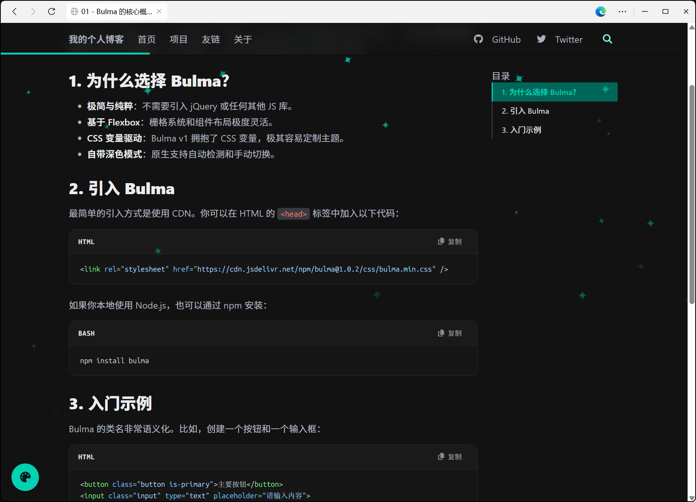



# 🌱 Bulma-Garden

**一个基于 Bulma 与原生 JS 的极简、优雅、高性能纯静态博客系统**

🚀 **[在线预览 (Live Demo)](https://thss192.github.io/Bulma-Garden/)** 

*无需任何构建工具（Webpack/Vite/Nuxt），不需要数据库，无需安装 Node.js 环境即可直接双击运行。完美适配 GitHub Pages 等静态托管服务。*

---

## ✨ 为什么选择 Bulma-Garden？

市面上有很多博客框架，但大部分需要你配置繁杂的 Node.js 环境或学习新的框架语法。**Bulma-Garden 的哲学是：“零依赖，开箱即用”**。

你只需要懂最基础的 Markdown，就能拥有一个极具现代感、丝滑流畅的个人数字花园。

### 🎨 核心特性 (Features)

- **极致外观与多主题**：完美支持亮暗模式一键切换，内置 **6 套精选配色**（薄荷、森林、樱花、海洋、落日、极简）。
- **动态视觉特效**：纯手工打磨的 **Canvas 粒子引擎**，提供星空、爱心、花朵飘落及点击爆炸效果，支持透明度实时调节，且经过了极致的性能优化（稳定 60 FPS）。
- **生动的首页体验**：首页标题支持**打字机逐字渲染**（完美兼容 Emoji 等特殊字符），侧边栏集成**时间感知问候**。
- **极简架构**：HTML + CSS + 原生 JS，零第三方运行时依赖，拒绝臃肿。
- **数据与视图彻底分离**：全站文案、功能开关、作者信息、项目友链均由 `config.json` 等 JSON 文件驱动，改数据不改代码。
- **通用化组件**：利用 Web Components 封装了 `<code-block>`，样式完全隔离，支持一键复制。
- **沉浸式阅读**：自动生成目录（TOC）、阅读进度条、代码高亮、图片点击放大。
- **本地全文搜索**：基于 JSON 索引的极速全文搜索，支持 `Ctrl+K` 快速唤起。

---

## 📸 界面截图

<table align="center" style="border-collapse: collapse; border: none;">
  <tr>
    <td align="center" width="50%">
      
       ✨ 首页亮色模式
    </td>
    <td align="center" width="50%">
      
       🌙 文章暗色模式
    </td>
  </tr>
  <tr>
    <td align="center" width="50%">
      
       🎨 自定义主题与特效
    </td>
    <td align="center" width="50%">
      
       📝 沉浸式文章阅读
    </td>
  </tr>
</table>

## 🚀 快速开始 (Fork & Deploy)

想要拥有同款博客？只需要简单的三步：

### 第一步：克隆或 Fork 本仓库
将本项目下载到本地，或者直接 Fork 到你的 GitHub 账号下。

### 第二步：修改你的个人信息
打开 `config.json`，把你自己的信息替换进去：
~~~json
{
  "siteTitle": "你的博客名字",
  "author": {
    "name": "你的名字",
    "bio": "你的简介",
    "avatar": "images/avatar.png"
  },
  "features": {
    "effects": true,
    "search": true,
    "backToTop": true
  }
}
~~~

### 第三步：开始写作 & 部署
1. 在 `posts/` 目录下新建 `.md` 文件，写文章。
2. 运行 `node scripts/generate-index.js`（或使用本地开发流）更新文章索引。
3. 推送到 GitHub，在仓库设置中开启 **GitHub Pages**，即可发布！

---

## 🛠️ 本地开发指南

如果你想要在本地预览和调试，强烈推荐以下工作流：

1. **启动数据监听**：在终端运行 `node dev.js`。它会监听 `posts/` 等文件的改动，一旦保存，立刻自动更新索引数据。
2. **启动本地服务器**：使用 VSCode 的 **Live Server** 插件，右键 `index.html` -> `Open with Live Server`，或者直接运行 `start.bat`（Windows 用户）。
3. **开始调试**：浏览器会自动刷新，所见即所得。

---

## 📂 目录结构说明

~~~text
Bulma-Garden/
├── index.html                 # 首页
├── post.html                  # 文章详情页
├── config.json                # 站点全局配置（作者信息、功能开关、配色等）
├── custom.css                 # 核心自定义样式
├── custom-themes.css          # 调色盘面板与多主题变量、特效面板样式
├── js/
│   ├── common.js              # 公共逻辑（导航、搜索、主题状态应用）
│   ├── theme.js               # 调色盘与特效面板交互
│   ├── effects.js             # 高性能 Canvas 粒子引擎
│   ├── home.js                # 首页逻辑（打字机、动态问候、列表渲染）
│   ├── post.js                # 详情页逻辑（Markdown、CodeBlock、TOC）
│   └── ...
├── posts/                     # 存放 Markdown 文章和自动生成的 JSON 索引
└── scripts/                   # Node.js 构建脚本（生成索引、生成 RSS）
~~~

---

## 🤝 参与贡献

如果你想为这个项目添加新的特效、重构代码或完善文档，非常欢迎提交 Pull Request！
1. Fork 本仓库
2. 创建你的分支 (`git checkout -b feature/AmazingFeature`)
3. 提交更改 (`git commit -m 'Add some AmazingFeature'`)
4. 推送到分支 (`git push origin feature/AmazingFeature`)
5. 开启一个 Pull Request

---

## 📄 开源协议

- **代码**：基于 [MIT License](LICENSE.txt) 开源，你可以自由用于个人或商业项目。
- **博客文章内容**：基于 [CC BY-NC-SA 4.0](https://creativecommons.org/licenses/by-nc-sa/4.0/) 许可。

  <i>用最纯粹的技术，建最优雅的花园。</i>

